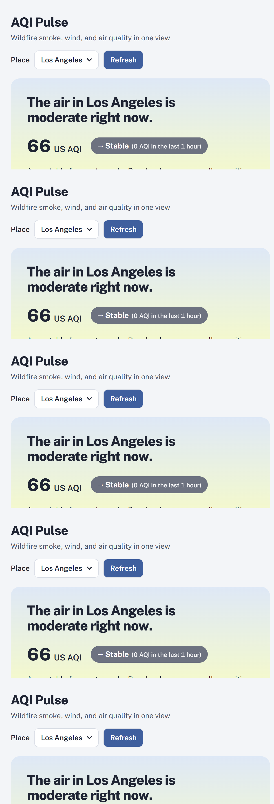

# AQI Pulse

A live page that puts nearby wildfires, wind, and air quality in one view.



## What the page shows

| Part | What it means |
| --- | --- |
| Sky band | Current US AQI, health note, and a 1-hour trend (Worsening / Stable / Improving) |
| Map | Fire detections in about the last 5 days within ~275 km, this hour’s wind, and an upwind wedge |
| Chart | Hourly US AQI for the last 24 hours, in the place’s local time |
| What changed | Three short lines: fires, wind, and air quality |

Pick **Los Angeles**, **Denver**, or **Seattle**, then use **Refresh** to reload.

Darker map dots are upwind. Fainter dots are older. The same hotspot seen by more than one satellite is drawn once.

## Run it

You need Python 3. Do not open `index.html` as a file. Use the local server.

**Windows**

```powershell
py server.py
```

**Mac**

```bash
python3 server.py
```

Then open [http://127.0.0.1:8000/](http://127.0.0.1:8000/).

### Preview without a NASA key

No `.env` file is required. Without a key, the map shows labeled **DEMO SAMPLE** fire locations so you can try the layout. Wind, air quality, and map tiles still load live.

### Live fire data

1. Request a key from the [NASA FIRMS API page](https://firms.modaps.eosdis.nasa.gov/api).
2. Create a `.env` file in the project root:

```text
MAP_KEY=your_key_here
```

3. Restart the server.

The server keeps the key out of the browser. `.env` is Git-ignored.

## Data

- [NASA FIRMS](https://firms.modaps.eosdis.nasa.gov/) — VIIRS near-real-time fire detections
- [Open-Meteo Air Quality](https://open-meteo.com/en/docs/air-quality-api) — hourly US AQI
- [Open-Meteo Weather](https://open-meteo.com/en/docs) — wind speed and direction
- [OpenFreeMap](https://openfreemap.org/) — map tiles

## Write-up

- [Findings](docs/findings.md) — answers to the three research questions
- [Design notes](docs/design-notes.md) — why the chart, trend rule, and map look this way
- [Brightspace checklist](docs/brightspace-checklist.md) — how to package the Dropbox upload
- [Project proposal](docs/project-proposal.pdf)

## Tests

```bash
node --test
```

## Course

COMP 6934 group project, Memorial University of Newfoundland.
